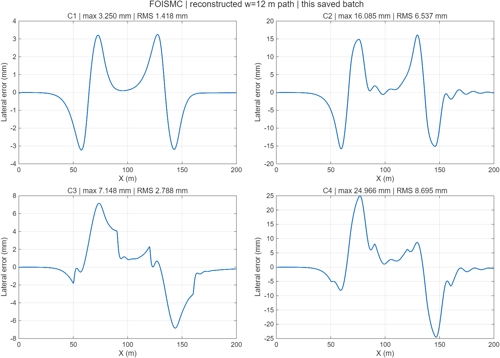

# FOISMC 车道保持案例

我们用该工作流复现了论文的联合仿真实验结构，组合四个工况和三种策略，使用 CarSim 2021 原生求解器与 MATLAB R2025b / Simulink。流程从控制器和参考轨迹开始，再核对车辆接口、正式运行、出图和回放。

- 初版用通用 S-Function 调用官方 `vs_sf`，交付版换用官方库模块。相同车辆和参数下，四个 FOISMC 工况的时间序列对照一致。
- 十二组正式结果来自实际联合仿真。TISMC-R 与 FOPID-R 是重构基线，参考路径使用 12 m 重构设置。
- CPAR 导入、重跑和 CarSim Video 回放分别验证。回放通过求解器记录和播放器入口关联实现。
- 结论限于工程流程和已核对的数据。车辆、轨迹与基线差异影响与论文图的直接比较。

论文：[Wu 等，Design of a fractional-order sliding mode controller for lane- keeping in autonomous driving](https://doi.org/10.1038/s41598-025-18883-1)。图为本项目实验结果。完整课程工程与验证资料按作业提交安排提供。
